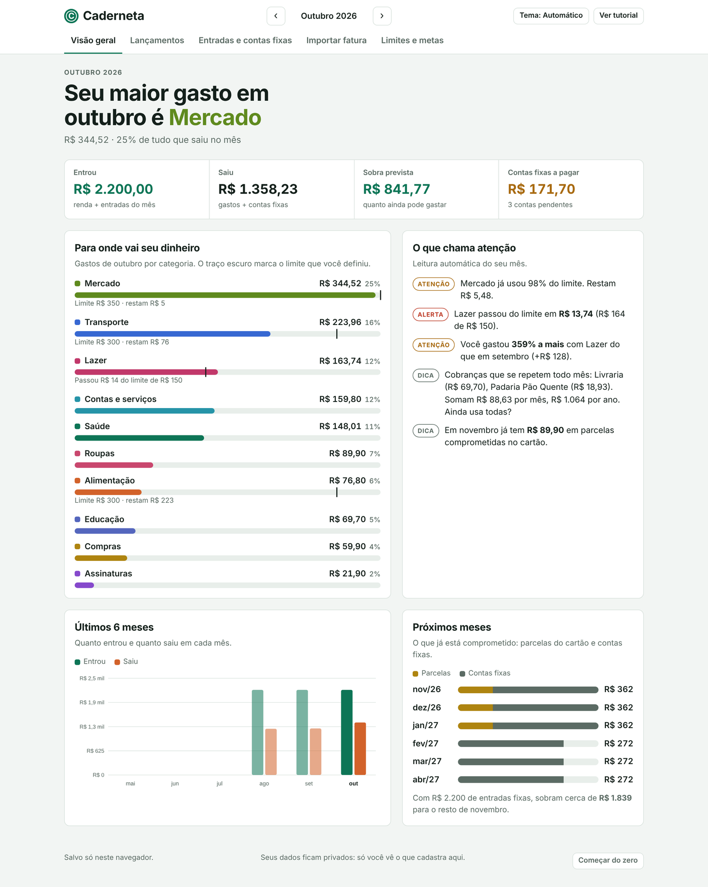
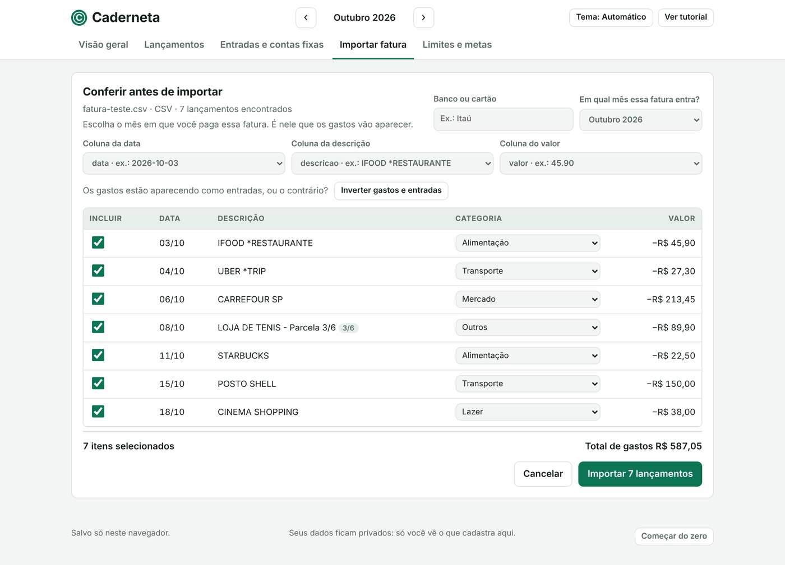

# 📒 Caderneta · Controle de gastos sem planilha

App web de finanças pessoais que eu criei para controlar os meus gastos, e que hoje também é usado por parentes e amigos.

🔗 **Acesse:** [https://isabella-cavalcanti.github.io/Caderneta/]

## Por que eu fiz
Eu queria controlar os meus gastos, mas a planilha de Excel me parecia ultrapassada: nela eu não conseguia simplesmente jogar a fatura do cartão e ter tudo calculado. Então criei a Caderneta e fiz **automações no celular** que mandam os gastos direto para o site.

## O que ela faz
- 📥 **Importa a fatura do cartão** (CSV ou OFX, inclusive a do Nubank) e já calcula tudo
- 📆 **Distribui as compras parceladas** nos meses certos, automaticamente
- 📊 **Dashboards** para ver para onde o dinheiro está indo
- 🔔 **Avisos** que ajudam a controlar os gastos antes de estourar o orçamento
- 💰 Renda, gastos, **contas fixas** e **metas** num só lugar
- 🌙 Tema escuro

## Privacidade
Os dados ficam salvos **só no navegador de cada pessoa** (localStorage). Nada é enviado para servidor.

## Prints
*Dados de exemplo, criados só para os prints.*

**Visão geral:** maior gasto do mês, limites por categoria, avisos e parcelas dos próximos meses

**Importar fatura:** a Caderneta lê o arquivo, sugere a categoria de cada gasto e reconhece as parcelas

## Tecnologias
HTML · CSS · JavaScript puro · automações no celular
